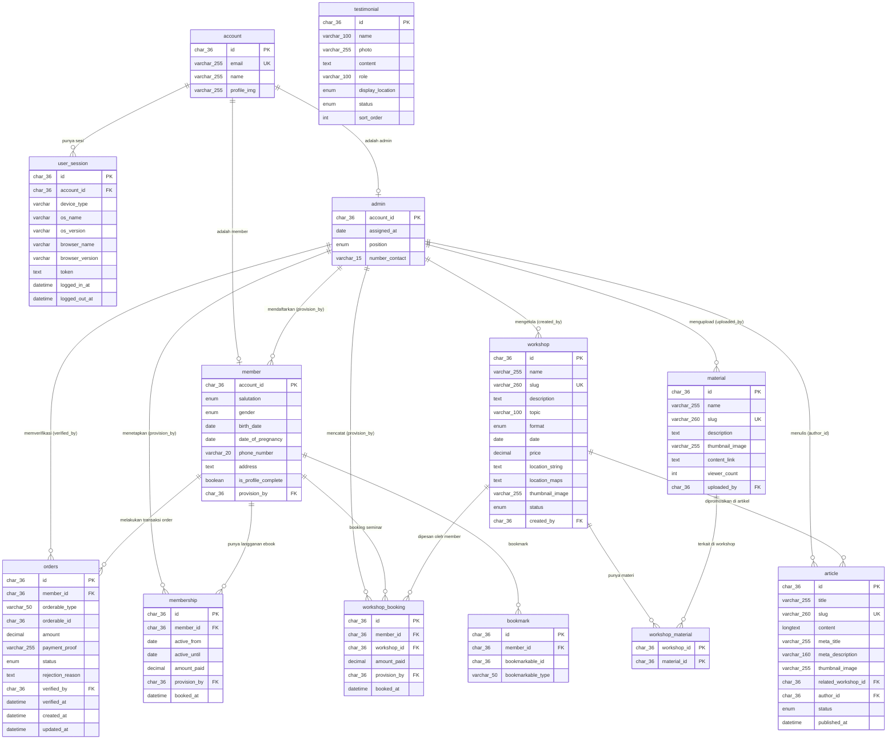

# Entity Relationship Diagram — Maternity.id
> Database: MySQL | Disesuaikan dengan SRS | Last updated: 23 Juli 2026 (Revisi Pembayaran Manual & Profile Completion)

---

## Diagram ERD

---

## Deskripsi Tabel

### USER SECTION

#### `account`
Tabel utama identitas pengguna. Semua aktor (member, admin) berasal dari tabel ini via Google OAuth. Tidak menyimpan password (FR-03).

| Kolom | Tipe | Constraint | Keterangan |
|---|---|---|---|
| `id` | `char(36)` | PK, UNIQUE, NOT NULL | UUID |
| `email` | `varchar(255)` | UNIQUE, NOT NULL | Email Google OAuth |
| `name` | `varchar(255)` | NOT NULL | Nama dari Google |
| `profile_img` | `varchar(255)` | NULLABLE | URL foto profil dari Google |

---

#### `user_session`
Menyimpan riwayat sesi login pengguna. Digunakan untuk validasi token dan tracking device (FR-03).

| Kolom | Tipe | Constraint | Keterangan |
|---|---|---|---|
| `id` | `char(36)` | PK, UNIQUE | UUID sesi |
| `account_id` | `char(36)` | FK → `account.id`, NOT NULL | Pemilik sesi |
| `device_type` | `varchar` | NULLABLE | Mobile / Desktop |
| `os_name` | `varchar` | NULLABLE | Contoh: Windows, iOS |
| `os_version` | `varchar` | NULLABLE | Versi OS |
| `browser_name` | `varchar` | NULLABLE | Chrome, Safari, dsb. |
| `browser_version` | `varchar` | NULLABLE | Versi browser |
| `token` | `text` | NOT NULL | Bearer token / Sesi token |
| `logged_in_at` | `datetime` | NOT NULL | Waktu login |
| `logged_out_at` | `datetime` | NULLABLE | Waktu logout (null = masih aktif) |

---

#### `member`
Data profil tambahan untuk pengguna yang sudah terdaftar. Diisi atau dilengkapi melalui alur "Lengkapi Data Diri" (`/complete-profile`) setelah login Google pertama kali.

| Kolom | Tipe | Constraint | Keterangan |
|---|---|---|---|
| `account_id` | `char(36)` | PK, FK → `account.id` | 1-to-1 dengan account |
| `salutation` | `enum` | NOT NULL | Ibu / Bunda / Mbak / dsb. |
| `gender` | `enum` | NOT NULL | Jenis kelamin |
| `birth_date` | `date` | NOT NULL | Tanggal lahir |
| `date_of_pregnancy` | `date` | NULLABLE | Perkiraan lahir (HPL), jika hamil |
| `phone_number` | `varchar(20)` | NULLABLE | Nomor HP/WhatsApp aktif |
| `address` | `text` | NULLABLE | Alamat domisili member |
| `is_profile_complete` | `boolean` | NOT NULL, DEFAULT false | Flag status kelengkapan data diri |
| `provision_by` | `char(36)` | FK → `admin.account_id`, NULLABLE | Admin yang mendaftarkan/mengonfirmasi |

---

#### `admin`
Data profil admin yang mengelola konten, langganan, seminar, verifikasi order, artikel, dan testimoni.

| Kolom | Tipe | Constraint | Keterangan |
|---|---|---|---|
| `account_id` | `char(36)` | PK, FK → `account.id` | 1-to-1 dengan account |
| `assigned_at` | `date` | NOT NULL | Tanggal ditugaskan sebagai admin |
| `position` | `enum` | NOT NULL | `maintainer` atau `consultant` |
| `number_contact` | `varchar(15)` | NOT NULL | Nomor WA/HP admin |

---

### CONTENT SECTION

#### `material`
Tabel untuk menyimpan e-book atau materi edukatif yang dapat diakses member sesuai langganannya (FR-11, FR-15).

| Kolom | Tipe | Constraint | Keterangan |
|---|---|---|---|
| `id` | `char(36)` | PK, UNIQUE | UUID |
| `name` | `varchar(255)` | NOT NULL | Judul materi/e-book |
| `slug` | `varchar(260)` | UNIQUE, NOT NULL | URL-friendly identifier |
| `description` | `text` | NULLABLE | Deskripsi singkat |
| `thumbnail_image` | `varchar(255)` | NULLABLE | URL thumbnail/cover |
| `content_link` | `text` | NOT NULL | Link ke file/konten (Google Drive, dsb.) |
| `viewer_count` | `int` | NOT NULL, DEFAULT 0 | Jumlah penonton/unduhan |
| `uploaded_by` | `char(36)` | FK → `admin.account_id`, NOT NULL | Admin yang mengupload materi |

---

#### `workshop`
Tabel seminar/pelatihan. Kolom `topic`, `format`, `price`, dan `status` mendukung filter katalog (FR-04) dan landing page (FR-01).

| Kolom | Tipe | Constraint | Keterangan |
|---|---|---|---|
| `id` | `char(36)` | PK, UNIQUE | UUID |
| `name` | `varchar(255)` | NOT NULL | Nama seminar/workshop |
| `slug` | `varchar(260)` | UNIQUE, NOT NULL | URL-friendly untuk routing detail |
| `description` | `text` | NOT NULL | Deskripsi lengkap |
| `topic` | `varchar(100)` | NOT NULL | Topik seminar (Yoga, Laktasi, Nifas) |
| `format` | `enum` | NOT NULL | `online` / `offline` / `hybrid` |
| `date` | `date` | NOT NULL | Tanggal pelaksanaan |
| `price` | `decimal(10,2)` | NOT NULL, DEFAULT 0 | Harga seminar |
| `location_string` | `text` | NULLABLE | Alamat teks |
| `location_maps` | `text` | NULLABLE | URL Google Maps embed |
| `thumbnail_image` | `varchar(255)` | NULLABLE | URL gambar cover seminar |
| `status` | `enum` | NOT NULL, DEFAULT 'upcoming' | `upcoming` / `ongoing` / `done` / `cancelled` |
| `created_by` | `char(36)` | FK → `admin.account_id`, NOT NULL | Admin yang membuat seminar |

---

#### `workshop_material`
Tabel pivot (junction) many-to-many antara `workshop` dan `material`.

| Kolom | Tipe | Constraint | Keterangan |
|---|---|---|---|
| `workshop_id` | `char(36)` | PK (composite), FK → `workshop.id` | |
| `material_id` | `char(36)` | PK (composite), FK → `material.id` | |

---

#### `article`
Menyimpan artikel edukasi SEO yang ditulis admin. Tiap artikel dapat dikaitkan ke satu workshop terkait untuk CTA promosi.

| Kolom | Tipe | Constraint | Keterangan |
|---|---|---|---|
| `id` | `char(36)` | PK, UNIQUE | UUID |
| `title` | `varchar(255)` | NOT NULL | Judul artikel |
| `slug` | `varchar(260)` | UNIQUE, NOT NULL | Slug SEO |
| `content` | `longtext` | NOT NULL | Isi artikel (rich text / HTML) |
| `meta_title` | `varchar(255)` | NULLABLE | Meta title SEO |
| `meta_description` | `varchar(160)` | NULLABLE | Meta description SEO |
| `thumbnail_image` | `varchar(255)` | NULLABLE | Gambar utama artikel |
| `related_workshop_id` | `char(36)` | FK → `workshop.id`, NULLABLE | Workshop yang dipromosikan |
| `author_id` | `char(36)` | FK → `admin.account_id`, NOT NULL | Admin penulis artikel |
| `status` | `enum` | NOT NULL, DEFAULT 'draft' | `draft` / `published` |
| `published_at` | `datetime` | NULLABLE | Waktu publish |

---

#### `testimonial`
Menyimpan testimoni pengguna yang dikurasi admin. Ditampilkan di landing page dan/atau halaman checkout.

| Kolom | Tipe | Constraint | Keterangan |
|---|---|---|---|
| `id` | `char(36)` | PK, UNIQUE | UUID |
| `name` | `varchar(100)` | NOT NULL | Nama pemberi testimoni |
| `photo` | `varchar(255)` | NULLABLE | URL foto profil |
| `content` | `text` | NOT NULL | Isi testimoni |
| `role` | `varchar(100)` | NULLABLE | Peran/deskripsi (mis. "Peserta Seminar Laktasi") |
| `display_location` | `enum` | NOT NULL | `landing` / `checkout` / `both` |
| `status` | `enum` | NOT NULL, DEFAULT 'hidden' | `published` / `hidden` |
| `sort_order` | `int` | NOT NULL, DEFAULT 0 | Urutan tampil |

---

#### `bookmark`
Menyimpan bookmark seminar atau materi yang disimpan member.

| Kolom | Tipe | Constraint | Keterangan |
|---|---|---|---|
| `id` | `char(36)` | PK, UNIQUE | UUID |
| `member_id` | `char(36)` | FK → `member.account_id`, NOT NULL | Member yang melakukan bookmark |
| `bookmarkable_id` | `char(36)` | NOT NULL | Target ID (`workshop.id` / `material.id`) |
| `bookmarkable_type` | `varchar(50)` | NOT NULL | `workshop` atau `material` |

---

### OPERATIONAL & ORDERS SECTION

#### `orders` *(Tabel Baru)*
Menyimpan transaksi pemesanan & bukti pembayaran manual per booking seminar atau membership.

| Kolom | Tipe | Constraint | Keterangan |
|---|---|---|---|
| `id` | `char(36)` | PK | UUID order |
| `member_id` | `char(36)` | FK → `member.account_id`, NOT NULL | Pemesan |
| `orderable_type` | `varchar(50)` | NOT NULL | Polymorphic: `workshop_booking` atau `membership` |
| `orderable_id` | `char(36)` | NOT NULL | ID entitas target |
| `amount` | `decimal(10,2)` | NOT NULL | Nominal yang harus dibayar |
| `payment_proof` | `varchar(255)` | NULLABLE | Path file screenshot bukti bayar |
| `status` | `enum` | NOT NULL, DEFAULT 'menunggu_pembayaran' | `menunggu_pembayaran`, `menunggu_verifikasi`, `diverifikasi`, `ditolak`, `selesai` |
| `rejection_reason` | `text` | NULLABLE | Catatan alasan penolakan jika status `ditolak` |
| `verified_by` | `char(36)` | FK → `admin.account_id`, NULLABLE | Admin yang memverifikasi order |
| `verified_at` | `datetime` | NULLABLE | Timestamp verifikasi admin |
| `created_at` | `datetime` | NOT NULL | Timestamp order dibuat |
| `updated_at` | `datetime` | NOT NULL | Timestamp order diperbarui |

---

#### `membership`
Menyimpan data **Langganan Akses Ebook** aktif/terlampir setelah order diverifikasi admin.

| Kolom | Tipe | Constraint | Keterangan |
|---|---|---|---|
| `id` | `char(36)` | PK | UUID |
| `member_id` | `char(36)` | FK → `member.account_id`, NOT NULL | Pemegang langganan |
| `active_from` | `date` | NOT NULL | Awal masa aktif |
| `active_until` | `date` | NOT NULL | Akhir masa aktif |
| `amount_paid` | `decimal(10,2)` | NOT NULL | Nominal pembayaran |
| `provision_by` | `char(36)` | FK → `admin.account_id`, NOT NULL | Admin yang mengaktifkan |
| `booked_at` | `datetime` | NOT NULL | Timestamp pencatatan oleh admin |

---

#### `workshop_booking`
Menyimpan data **Langganan Akses Seminar** aktif/terlampir setelah order diverifikasi admin.

| Kolom | Tipe | Constraint | Keterangan |
|---|---|---|---|
| `id` | `char(36)` | PK | UUID |
| `member_id` | `char(36)` | FK → `member.account_id`, NOT NULL | Member yang memesan |
| `workshop_id` | `char(36)` | FK → `workshop.id`, NOT NULL | Workshop yang dipesan |
| `amount_paid` | `decimal(10,2)` | NOT NULL | Nominal pembayaran |
| `provision_by` | `char(36)` | FK → `admin.account_id`, NOT NULL | Admin yang mengaktifkan |
| `booked_at` | `datetime` | NOT NULL | Timestamp pencatatan oleh admin |

---

## Ringkasan Relasi

| Relasi | Kardinalitas | Keterangan |
|---|---|---|
| `account` → `user_session` | 1 : N | Satu akun bisa punya banyak sesi login |
| `account` → `member` | 1 : 1 | Satu akun sebagai member |
| `account` → `admin` | 1 : 1 | Satu akun sebagai admin |
| `member` → `orders` | 1 : N | Satu member melakukan banyak order transaksi |
| `admin` → `orders` | 1 : N | Admin memverifikasi transaksi order (`verified_by`) |
| `orders` → `membership`/`workshop_booking` | 1 : 1 | Order memuat transaksi polymorphic menuju entitas produk |
| `member` → `membership` | 1 : N | Satu member memiliki banyak riwayat langganan ebook |
| `member` → `workshop_booking` | 1 : N | Satu member memiliki banyak riwayat booking seminar |
| `workshop` → `workshop_material` | 1 : N | Pivot relasi seminar ke e-book materi |
| `material` → `workshop_material` | 1 : N | Pivot relasi e-book materi ke seminar |

---

## Mapping FR → Tabel

| FR | Kebutuhan | Tabel Terkait |
|---|---|---|
| FR-01 | Landing page + Section Mitra | `workshop`, `article`, `testimonial` |
| FR-03 | Google OAuth + Lengkapi Data Diri | `account`, `user_session`, `member` (`is_profile_complete`, `phone_number`, `address`) |
| FR-04 | Filter katalog seminar | `workshop` |
| FR-05 | Checkout & Pembayaran Manual | `orders` (status, payment_proof, amount) |
| FR-06 | Upload Bukti Bayar & Email Konfirmasi | `orders`, `member`, `account` |
| FR-07 | Akses ebook otomatis dari seminar | `workshop_booking` + `workshop_material` + `material` |
| FR-09 | Admin Verifikasi Order (`admin/orders`) | `orders`, `membership`, `workshop_booking`, `admin` |
| FR-11 | Library ebook | `material`, `membership`, `workshop_booking`, `workshop_material` |
| FR-12 | Bookmark | `bookmark` |
| FR-13 | Edit profil | `member`, `account` |
| FR-14 | Status Pesanan Real-time | `orders` (`/orders/{id}`) |
| FR-15 | Admin CRUD materi | `material`, `workshop_material` |
| FR-16 | Admin kelola member & langganan | `member`, `membership`, `workshop_booking` |
| FR-17 | Admin CRUD seminar | `workshop` |
| FR-18 | Admin Finance Dashboard | Agregasi data dari `orders` & `membership` / `workshop_booking` |
| FR-19 | Artikel SEO | `article` |
| FR-20 | Tombol Fasilitator Event | *Tidak ada tabel (direct link WA)* |
| FR-21 | Testimoni | `testimonial` |
| FR-22 | Admin CRUD testimoni | `testimonial` |
