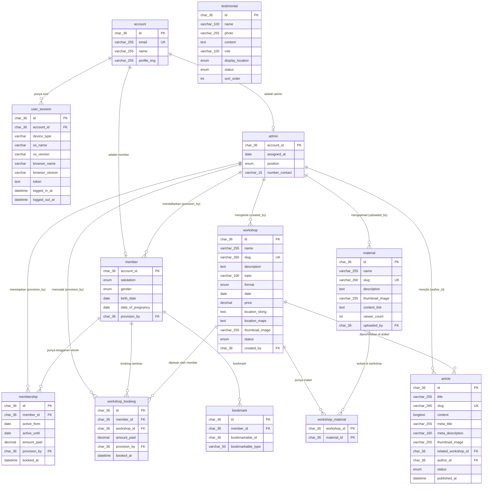

# Entity Relationship Diagram — Maternity.id
> Database: MySQL | Disesuaikan dengan SRS | Last updated: 23 Juli 2026

---

## Diagram ERD

---

## Deskripsi Tabel

### USER SECTION

#### `account`
Tabel utama identitas pengguna. Semua aktor (member, admin) berasal dari tabel ini via Google OAuth. Tidak menyimpan password (FR-03).

| Kolom | Tipe | Constraint | Keterangan |
|---|---|---|---|
| `id` | `char(36)` | PK, UNIQUE, NOT NULL | UUID |
| `email` | `varchar(255)` | UNIQUE, NOT NULL | Email Google OAuth |
| `name` | `varchar(255)` | NOT NULL | Nama dari Google |
| `profile_img` | `varchar(255)` | NULLABLE | URL foto profil dari Google |

---

#### `user_session`
Menyimpan riwayat sesi login pengguna. Digunakan untuk validasi token dan tracking device (FR-03).

| Kolom | Tipe | Constraint | Keterangan |
|---|---|---|---|
| `id` | `char(36)` | PK, UNIQUE | UUID sesi |
| `account_id` | `char(36)` | FK → `account.id`, NOT NULL | Pemilik sesi |
| `device_type` | `varchar` | NULLABLE | Mobile / Desktop |
| `os_name` | `varchar` | NULLABLE | Contoh: Windows, iOS |
| `os_version` | `varchar` | NULLABLE | Versi OS |
| `browser_name` | `varchar` | NULLABLE | Chrome, Safari, dsb. |
| `browser_version` | `varchar` | NULLABLE | Versi browser |
| `token` | `text` | NOT NULL | Bearer token / Sanctum token |
| `logged_in_at` | `datetime` | NOT NULL | Waktu login |
| `logged_out_at` | `datetime` | NULLABLE | Waktu logout (null = masih aktif) |

---

#### `member`
Data profil tambahan untuk pengguna yang sudah terdaftar. Diisi setelah Google login pertama kali (FR-13).

| Kolom | Tipe | Constraint | Keterangan |
|---|---|---|---|
| `account_id` | `char(36)` | PK, FK → `account.id` | 1-to-1 dengan account |
| `salutation` | `enum` | NOT NULL | Ibu / Bunda / dsb. |
| `gender` | `enum` | NOT NULL | Jenis kelamin |
| `birth_date` | `date` | NOT NULL | Tanggal lahir |
| `date_of_pregnancy` | `date` | NULLABLE | Perkiraan lahir (HPL), jika hamil |
| `provision_by` | `char(36)` | FK → `admin.account_id`, NOT NULL | Admin yang mendaftarkan |

---

#### `admin`
Data profil admin yang dapat mengelola konten, langganan, seminar, artikel, dan testimoni (FR-09, FR-15–FR-18, FR-22).

| Kolom | Tipe | Constraint | Keterangan |
|---|---|---|---|
| `account_id` | `char(36)` | PK, FK → `account.id` | 1-to-1 dengan account |
| `assigned_at` | `date` | NOT NULL | Tanggal ditugaskan sebagai admin |
| `position` | `enum` | NOT NULL | `maintainer` atau `consultant` |
| `number_contact` | `varchar(15)` | NOT NULL | Nomor WA/HP admin |

---

### CONTENT SECTION

#### `material`
Tabel untuk menyimpan e-book atau materi edukatif yang dapat diakses member sesuai langganannya (FR-11, FR-15).

| Kolom | Tipe | Constraint | Keterangan |
|---|---|---|---|
| `id` | `char(36)` | PK, UNIQUE | UUID |
| `name` | `varchar(255)` | NOT NULL | Judul materi/e-book |
| `slug` | `varchar(260)` | UNIQUE, NOT NULL | URL-friendly identifier |
| `description` | `text` | NULLABLE | Deskripsi singkat |
| `thumbnail_image` | `varchar(255)` | NULLABLE | URL thumbnail/cover |
| `content_link` | `text` | NOT NULL | Link ke file/konten (Google Drive, dsb.) |
| `viewer_count` | `int` | NOT NULL, DEFAULT 0 | Jumlah penonton/unduhan |
| `uploaded_by` | `char(36)` | FK → `admin.account_id`, NOT NULL | Admin yang mengupload materi (FR-15) |

---

#### `workshop`
Tabel seminar/pelatihan. Kolom `topic`, `format`, `price`, dan `status` ditambahkan untuk mendukung fitur filter katalog (FR-04) dan landing page (FR-01).

| Kolom | Tipe | Constraint | Keterangan |
|---|---|---|---|
| `id` | `char(36)` | PK, UNIQUE | UUID |
| `name` | `varchar(255)` | NOT NULL | Nama seminar/workshop |
| `slug` | `varchar(260)` | UNIQUE, NOT NULL | URL-friendly untuk routing halaman detail |
| `description` | `text` | NOT NULL | Deskripsi lengkap |
| `topic` | `varchar(100)` | NOT NULL | Topik seminar (mis. Yoga, Laktasi, Nifas) — filter FR-04 |
| `format` | `enum` | NOT NULL | `online` / `offline` / `hybrid` — filter FR-04 |
| `date` | `date` | NOT NULL | Tanggal pelaksanaan |
| `price` | `decimal` | NOT NULL, DEFAULT 0 | Harga seminar — filter FR-04 |
| `location_string` | `text` | NULLABLE | Alamat teks (mis. "Gedung X, Solo") |
| `location_maps` | `text` | NULLABLE | URL Google Maps embed |
| `thumbnail_image` | `varchar(255)` | NULLABLE | URL gambar cover seminar |
| `status` | `enum` | NOT NULL, DEFAULT 'upcoming' | `upcoming` / `ongoing` / `done` / `cancelled` |
| `created_by` | `char(36)` | FK → `admin.account_id`, NOT NULL | Admin yang mengunggah (FR-17) |

> `location_string` & `location_maps` bisa NULLABLE karena seminar online tidak perlu lokasi fisik.

---

#### `workshop_material`
Tabel pivot (junction) many-to-many antara `workshop` dan `material` (FR-15).

| Kolom | Tipe | Constraint | Keterangan |
|---|---|---|---|
| `workshop_id` | `char(36)` | PK (composite), FK → `workshop.id` | |
| `material_id` | `char(36)` | PK (composite), FK → `material.id` | |

> **FR-07 implementasi**: Saat `workshop_booking` dibuat untuk workshop X, sistem query `workshop_material` untuk tahu e-book mana yang termasuk paket seminar itu → akses otomatis granted.

---

#### `article` *(tabel baru — FR-19)*
Menyimpan artikel edukasi SEO yang ditulis admin. Tiap artikel dapat dikaitkan ke satu workshop terkait untuk CTA promosi di bagian bawah artikel.

| Kolom | Tipe | Constraint | Keterangan |
|---|---|---|---|
| `id` | `char(36)` | PK, UNIQUE | UUID |
| `title` | `varchar(255)` | NOT NULL | Judul artikel |
| `slug` | `varchar(260)` | UNIQUE, NOT NULL | URL-friendly slug (SEO) |
| `content` | `longtext` | NOT NULL | Isi artikel (rich text / HTML) |
| `meta_title` | `varchar(255)` | NULLABLE | Meta title untuk SEO |
| `meta_description` | `varchar(160)` | NULLABLE | Meta description untuk SEO (maks 160 karakter) |
| `thumbnail_image` | `varchar(255)` | NULLABLE | Gambar utama artikel (OG image) |
| `related_workshop_id` | `char(36)` | FK → `workshop.id`, NULLABLE | Workshop yang dipromosikan di akhir artikel |
| `author_id` | `char(36)` | FK → `admin.account_id`, NOT NULL | Admin penulis artikel |
| `status` | `enum` | NOT NULL, DEFAULT 'draft' | `draft` / `published` |
| `published_at` | `datetime` | NULLABLE | Waktu publish (null = belum published) |

---

#### `testimonial` *(tabel baru — FR-21, FR-22)*
Menyimpan testimoni pengguna yang dikurasi admin. Ditampilkan di landing page dan/atau halaman checkout.

| Kolom | Tipe | Constraint | Keterangan |
|---|---|---|---|
| `id` | `char(36)` | PK, UNIQUE | UUID |
| `name` | `varchar(100)` | NOT NULL | Nama pemberi testimoni |
| `photo` | `varchar(255)` | NULLABLE | URL foto profil |
| `content` | `text` | NOT NULL | Isi testimoni |
| `role` | `varchar(100)` | NULLABLE | Peran/deskripsi (mis. "Peserta Seminar Laktasi") |
| `display_location` | `enum` | NOT NULL | `landing` / `checkout` / `both` — menentukan di mana tampil |
| `status` | `enum` | NOT NULL, DEFAULT 'hidden' | `published` / `hidden` — admin toggle tayang (FR-22) |
| `sort_order` | `int` | NOT NULL, DEFAULT 0 | Urutan tampil |

---

#### `bookmark` *(tabel baru — FR-12)*
Menyimpan bookmark seminar atau materi yang disimpan member. Menggunakan polymorphic design agar bisa bookmark dua tipe konten.

| Kolom | Tipe | Constraint | Keterangan |
|---|---|---|---|
| `id` | `char(36)` | PK, UNIQUE | UUID |
| `member_id` | `char(36)` | FK → `member.account_id`, NOT NULL | Member yang melakukan bookmark |
| `bookmarkable_id` | `char(36)` | NOT NULL | ID target (workshop.id atau material.id) |
| `bookmarkable_type` | `varchar(50)` | NOT NULL | `workshop` atau `material` |

> Index UNIQUE pada `(member_id, bookmarkable_id, bookmarkable_type)` untuk mencegah duplikat bookmark.

---

### OPERATIONAL

#### `membership`
Menyimpan data **Langganan Akses Ebook** — memberi akses ke seluruh materi selama masa berlaku (FR-05a, FR-09, FR-14).

| Kolom | Tipe | Constraint | Keterangan |
|---|---|---|---|
| `id` | `char(36)` | PK | UUID |
| `member_id` | `char(36)` | FK → `member.account_id`, NOT NULL | Pemegang langganan |
| `active_from` | `date` | NOT NULL | Awal masa aktif |
| `active_until` | `date` | NOT NULL | Akhir masa aktif |
| `amount_paid` | `decimal(10,2)` | NOT NULL | Nominal pembayaran |
| `provision_by` | `char(36)` | FK → `admin.account_id`, NOT NULL | Admin yang mengaktifkan (FR-09) |
| `booked_at` | `datetime` | NOT NULL | Timestamp pencatatan oleh admin |

---

#### `workshop_booking`
Menyimpan data **Langganan Akses Seminar** — akses ke satu workshop beserta materi terkaitnya otomatis (FR-05b, FR-07, FR-09, FR-14).

| Kolom | Tipe | Constraint | Keterangan |
|---|---|---|---|
| `id` | `char(36)` | PK | UUID |
| `member_id` | `char(36)` | FK → `member.account_id`, NOT NULL | Member yang memesan |
| `workshop_id` | `char(36)` | FK → `workshop.id`, NOT NULL | Workshop yang dipesan |
| `amount_paid` | `decimal(10,2)` | NOT NULL | Nominal pembayaran |
| `provision_by` | `char(36)` | FK → `admin.account_id`, NOT NULL | Admin yang mengaktifkan (FR-09) |
| `booked_at` | `datetime` | NOT NULL | Timestamp pencatatan oleh admin |

---

## Ringkasan Relasi

| Relasi | Kardinalitas | FR | Keterangan |
|---|---|---|---|
| `account` → `user_session` | 1 : N | FR-03 | Satu akun bisa punya banyak sesi login |
| `account` → `member` | 1 : 1 | FR-03 | Satu akun bisa jadi satu member |
| `account` → `admin` | 1 : 1 | FR-03 | Satu akun bisa jadi satu admin |
| `admin` → `member` | 1 : N | FR-09 | Satu admin mendaftarkan banyak member |
| `admin` → `membership` | 1 : N | FR-09 | Satu admin menetapkan banyak langganan ebook |
| `admin` → `workshop_booking` | 1 : N | FR-09 | Satu admin mencatat banyak booking seminar |
| `admin` → `workshop` | 1 : N | FR-17 | Satu admin mengelola banyak seminar |
| `admin` → `article` | 1 : N | FR-19 | Satu admin menulis banyak artikel SEO |
| `member` → `membership` | 1 : N | FR-05a | Satu member bisa punya banyak langganan ebook |
| `member` → `workshop_booking` | 1 : N | FR-05b | Satu member bisa booking banyak seminar |
| `admin` → `material` | 1 : N | FR-15 | Satu admin bisa mengupload banyak materi |
| `member` → `bookmark` | 1 : N | FR-12 | Satu member bisa punya banyak bookmark |
| `workshop` → `workshop_material` | 1 : N | FR-15 | Satu workshop punya banyak entri pivot materi |
| `material` → `workshop_material` | 1 : N | FR-07 | Satu material terkait banyak workshop |
| `workshop` → `workshop_booking` | 1 : N | FR-05b | Satu workshop bisa dipesan banyak member |
| `workshop` → `article` | 1 : N | FR-19 | Satu workshop bisa dipromosikan di banyak artikel |

---

## Grouping Area (Updated)

| Area | Warna | Tabel |
|---|---|---|
| **User Section** | Cyan | `account`, `user_session`, `member`, `admin` |
| **Content Section** | Hijau | `material`, `workshop`, `workshop_material`, `article`, `testimonial`, `bookmark` |
| **Operational** | Ungu | `membership`, `workshop_booking` |

---

## Mapping FR → Tabel

| FR | Kebutuhan | Tabel Terkait |
|---|---|---|
| FR-01 | Landing page (seminar unggulan, artikel terbaru) | `workshop` (status=upcoming), `article` (status=published), `testimonial` |
| FR-03 | Login Google OAuth | `account`, `user_session` |
| FR-04 | Filter katalog (topik, lokasi, format, harga) | `workshop`.topic, format, location_string, price |
| FR-05a | Langganan Akses Ebook | `membership` |
| FR-05b | Langganan Akses Seminar | `workshop_booking` |
| FR-07 | Akses ebook otomatis saat langganan seminar | `workshop_booking` + `workshop_material` + `material` |
| FR-09 | Admin set langganan user | `membership`, `workshop_booking` (provision_by) |
| FR-11 | Library ebook (akses sesuai langganan) | `material`, `membership`, `workshop_booking`, `workshop_material` |
| FR-12 | Bookmark seminar/materi | `bookmark` |
| FR-13 | Edit profil member | `member`, `account` |
| FR-14 | Status langganan (jenis, aktif/expired) | `membership`, `workshop_booking` |
| FR-15 | Admin CRUD materi & kaitan ke seminar | `material`, `workshop_material` |
| FR-16 | Admin kelola user & langganan | `member`, `membership`, `workshop_booking` |
| FR-17 | Admin CRUD seminar | `workshop` |
| FR-18 | Dashboard keuangan admin | `membership`.amount_paid, `workshop_booking`.amount_paid |
| FR-19 | Artikel SEO (tulis, publish, tampilkan) | `article` |
| FR-20 | Tombol fasilitator → WA (no DB) | *tidak ada tabel — direct wa.me link* |
| FR-21 | Testimoni di landing & checkout | `testimonial` (display_location) |
| FR-22 | Admin CRUD testimoni & toggle tayang | `testimonial` (status, sort_order) |

---

## Catatan Desain

- **FR-20 (Fasilitator Event)** tidak memerlukan tabel — tombol langsung buka `wa.me` dengan pesan default, tanpa menyimpan data ke database (sesuai SRS 2.3.2)
- **`membership`** = Langganan Akses Ebook (semua materi, berbasis tanggal aktif)
- **`workshop_booking`** = Langganan Akses Seminar (per workshop + ebook terkait otomatis via `workshop_material`)
- **`material.uploaded_by`** FK ke `admin.account_id` — hanya admin yang bisa upload/mengelola e-book (FR-15) ✅
- Semua primary key menggunakan UUID `char(36)` → kompatibel dengan Laravel `Str::uuid()`
- Tidak ada kolom payment gateway / payment proof — semua checkout via WhatsApp Admin (FR-06)
- `article.meta_description` dibatasi `varchar(160)` mengikuti best practice SEO (SRS 2.4 — NFR SEO)
- `testimonial.display_location` enum `landing`/`checkout`/`both` mengikuti SRS FR-21 yang menyebutkan 2 lokasi tampil
